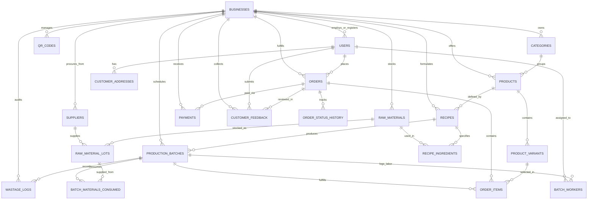

# Universal Multi-Tenant Bakery Platform — Database Schema Specification

## 1. Multi-Tenant Overview & Architecture

The **Universal Bakery Management System** database is structured as a multi-client, white-label SaaS platform supporting independent bakeries on a shared PostgreSQL database. Every operational record is strictly partitioned by `business_id`.

### Core Capabilities Supported:
- **Multi-Client Tenant Isolation**: All catalog, recipe, inventory, batch, order, and customer records belong to a specific `business_id`.
- **White-Label Branding & Settings**: Independent business name, slug, custom domain, theme colors, currency, timezone, and UPI VPA stored on the `businesses` entity.
- **Universal QR Code Engine**: Supports table ordering (`/b/:slug?table=X`), counter pickup, and direct UPI payment routing per tenant.
- **Unified Role System**: Clear separation across roles: `customer`, `staff`, `baker`, `manager`, `owner`.
- **Food Safety & Inventory Traceability**: Preserves full bi-directional traceability:  
  `Supplier Lot -> Raw Material Lot (FIFO) -> Production Batch -> Customer Order Item -> Customer Feedback`.
- **Order Lifecycle & Audit History**: Preserves all 7 order lifecycle stages with timestamped transitions.

---

## 2. Multi-Tenant Entity Relationship Diagram (ERD)



---

## 3. Data Dictionary & Table Definitions

### 3.1 Tenant & Business Settings

#### `businesses` (Tenant Entity)
Stores platform client bakeries, branding tokens, regional settings, and payment details.

| Column | Type | Constraints | Description |
|---|---|---|---|
| `id` | SERIAL | PK | Unique business tenant ID |
| `name` | VARCHAR(150) | NOT NULL | Business display name (e.g., "Crumb & Co.") |
| `slug` | VARCHAR(80) | UNIQUE, NOT NULL | URL-safe identifier (e.g., `crumbandco`) |
| `logo_url` | VARCHAR(255) | NULLABLE | Business brand logo URL |
| `primary_color` | VARCHAR(20) | DEFAULT '#5A3825' | Primary brand button & header color |
| `secondary_color` | VARCHAR(20) | DEFAULT '#8B5A2B' | Secondary accent color |
| `accent_color` | VARCHAR(20) | DEFAULT '#D96C8A' | Callout badge color |
| `currency` | VARCHAR(10) | DEFAULT 'INR' | Currency symbol & ISO code (`INR`, `USD`) |
| `timezone` | VARCHAR(50) | DEFAULT 'Asia/Kolkata' | Operating timezone |
| `contact_email` | VARCHAR(160) | NOT NULL | Official bakery contact email |
| `contact_phone` | VARCHAR(25) | NOT NULL | Bakery support phone number |
| `address_line1` | VARCHAR(255) | NOT NULL | Physical bakery address |
| `address_line2` | VARCHAR(255) | NULLABLE | Landmark or suite |
| `city` | VARCHAR(100) | NOT NULL | City |
| `postal_code` | VARCHAR(20) | NOT NULL | Postal code |
| `state` | VARCHAR(100) | NULLABLE | State / Province |
| `country` | VARCHAR(100) | DEFAULT 'India' | Country |
| `fssai_license` | VARCHAR(50) | NULLABLE | Regulatory food license number |
| `upi_vpa` | VARCHAR(120) | NULLABLE | Merchant UPI ID for QR payments |
| `theme_config` | JSONB | DEFAULT '{}' | Extended white-label UI parameters |
| `is_active` | BOOLEAN | DEFAULT TRUE | Active SaaS subscription flag |
| `created_at` | TIMESTAMP | DEFAULT CURRENT_TIMESTAMP | Registration date |
| `updated_at` | TIMESTAMP | DEFAULT CURRENT_TIMESTAMP | Last settings update |

#### `qr_codes` (Universal QR Engine)
Enables dynamic counter QR, table ordering QR, and payment routing per tenant.

| Column | Type | Constraints | Description |
|---|---|---|---|
| `id` | SERIAL | PK | QR identifier |
| `business_id` | INT | FK -> `businesses(id)` ON DELETE CASCADE | Associated business |
| `qr_type` | VARCHAR(40) | NOT NULL, CHECK(`qr_type` IN ('table_order', 'counter_pickup', 'direct_payment', 'digital_menu', 'custom')) | Purpose of the QR |
| `unique_code` | VARCHAR(100) | UNIQUE, NOT NULL | Machine-readable code (e.g. `QR-CRUMB-TBL-01`) |
| `target_url` | VARCHAR(255) | NOT NULL | Resolved destination URL |
| `location_tag` | VARCHAR(100) | NULLABLE | E.g. 'Table 1', 'Patio 4', 'Main Counter' |
| `is_active` | BOOLEAN | DEFAULT TRUE | Status toggle |
| `scan_count` | INT | DEFAULT 0 | Scan analytics counter |
| `created_at` | TIMESTAMP | DEFAULT CURRENT_TIMESTAMP | Creation timestamp |
| `updated_at` | TIMESTAMP | DEFAULT CURRENT_TIMESTAMP | Last modified |

---

### 3.2 User & Access Management

#### `users`
Stores actors belonging to a business. Supports roles: `customer`, `staff`, `baker`, `manager`, `owner`.

| Column | Type | Constraints | Description |
|---|---|---|---|
| `id` | SERIAL | PK | Unique user identifier |
| `business_id` | INT | FK -> `businesses(id)` ON DELETE CASCADE | Tenant reference |
| `name` | VARCHAR(120) | NOT NULL | Full name of the user |
| `email` | VARCHAR(160) | UNIQUE, NULLABLE | User email |
| `phone` | VARCHAR(20) | UNIQUE, NOT NULL | Mobile number for OTP/Login |
| `password_hash` | VARCHAR(255) | NULLABLE | Password hash for staff/owner |
| `role` | VARCHAR(20) | NOT NULL, CHECK(`role` IN ('customer', 'staff', 'baker', 'manager', 'owner')) | User role |
| `hourly_rate` | DECIMAL(8,2) | DEFAULT 0.00 | Staff hourly labor cost rate for batch costing |
| `is_active` | BOOLEAN | DEFAULT TRUE | Active status |
| `created_at` | TIMESTAMP | DEFAULT CURRENT_TIMESTAMP | Registration timestamp |

#### `customer_addresses`
| Column | Type | Constraints | Description |
|---|---|---|---|
| `id` | SERIAL | PK | Address ID |
| `business_id` | INT | FK -> `businesses(id)` ON DELETE CASCADE | Tenant reference |
| `user_id` | INT | FK -> `users(id)` ON DELETE CASCADE | Customer reference |
| `address_line1` | VARCHAR(255) | NOT NULL | Street address, flat/building |
| `city` | VARCHAR(100) | NOT NULL | City |
| `postal_code` | VARCHAR(20) | NOT NULL | Postal code |
| `contact_phone` | VARCHAR(20) | NOT NULL | Contact phone for delivery |
| `is_default` | BOOLEAN | DEFAULT FALSE | Default address flag |

---

### 3.3 Product Catalog & Categories (Tenant Scoped)

#### `categories`
| Column | Type | Constraints | Description |
|---|---|---|---|
| `id` | SERIAL | PK | Category ID |
| `business_id` | INT | FK -> `businesses(id)` ON DELETE CASCADE | Tenant reference |
| `name` | VARCHAR(100) | NOT NULL | Category name |
| `slug` | VARCHAR(120) | NOT NULL | URL slug (Scoped: `UNIQUE(business_id, slug)`) |
| `description` | TEXT | NULLABLE | Category description |
| `display_order` | INT | DEFAULT 0 | Display priority |
| `is_active` | BOOLEAN | DEFAULT TRUE | Visibility flag |

#### `products`
| Column | Type | Constraints | Description |
|---|---|---|---|
| `id` | SERIAL | PK | Product ID |
| `business_id` | INT | FK -> `businesses(id)` ON DELETE CASCADE | Tenant reference |
| `category_id` | INT | FK -> `categories(id)` ON DELETE RESTRICT | Category mapping |
| `name` | VARCHAR(150) | NOT NULL | Product name |
| `slug` | VARCHAR(180) | NOT NULL | URL slug (Scoped: `UNIQUE(business_id, slug)`) |
| `description` | TEXT | NULLABLE | Product description & allergens |
| `image_url` | VARCHAR(255) | NULLABLE | Product photo URL |
| `is_eggless` | BOOLEAN | DEFAULT FALSE | Dietary indicator |
| `shelf_life_days`| INT | DEFAULT 3 | Shelf life in days |
| `is_available` | BOOLEAN | DEFAULT TRUE | Availability toggle |
| `created_at` | TIMESTAMP | DEFAULT CURRENT_TIMESTAMP | Creation timestamp |

#### `product_variants`
| Column | Type | Constraints | Description |
|---|---|---|---|
| `id` | SERIAL | PK | Variant ID |
| `product_id` | INT | FK -> `products(id)` ON DELETE CASCADE | Parent product reference |
| `name` | VARCHAR(100) | NOT NULL | Variant label (e.g. "500g", "1kg", "Single") |
| `sku` | VARCHAR(50) | NOT NULL | Stock Keeping Unit code |
| `selling_price`| DECIMAL(10,2)| NOT NULL, CHECK(`selling_price` >= 0) | Selling price |
| `is_default` | BOOLEAN | DEFAULT FALSE | Default variant flag |
| `is_available` | BOOLEAN | DEFAULT TRUE | Stock availability |

---

### 3.4 Procurement & FIFO Raw Materials (Tenant Scoped)

#### `suppliers`
| Column | Type | Constraints | Description |
|---|---|---|---|
| `id` | SERIAL | PK | Supplier ID |
| `business_id` | INT | FK -> `businesses(id)` ON DELETE CASCADE | Tenant reference |
| `name` | VARCHAR(150) | NOT NULL | Supplier company name |
| `phone` | VARCHAR(25) | NOT NULL | Contact phone |
| `email` | VARCHAR(160) | NULLABLE | Supplier email |
| `gstin` | VARCHAR(20) | NULLABLE | Tax registration ID |

#### `raw_materials`
| Column | Type | Constraints | Description |
|---|---|---|---|
| `id` | SERIAL | PK | Material ID |
| `business_id` | INT | FK -> `businesses(id)` ON DELETE CASCADE | Tenant reference |
| `name` | VARCHAR(120) | NOT NULL | Ingredient name |
| `category` | VARCHAR(50) | NOT NULL | E.g. 'Flour', 'Dairy', 'Sweetener', 'Packaging' |
| `base_unit` | VARCHAR(15) | NOT NULL, CHECK(`base_unit` IN ('g', 'kg', 'ml', 'L', 'piece')) | Base tracking unit |
| `current_stock` | DECIMAL(12,3)| DEFAULT 0.000 | Current stock |
| `min_reorder_level`| DECIMAL(12,3)| DEFAULT 5.000 | Low-stock alert threshold |
| `safety_stock` | DECIMAL(12,3)| DEFAULT 2.000 | Safety reserve |
| `avg_cost_per_unit`| DECIMAL(10,4)| DEFAULT 0.0000 | Moving average unit cost |

#### `raw_material_lots` (FIFO Traceability)
| Column | Type | Constraints | Description |
|---|---|---|---|
| `id` | SERIAL | PK | Lot ID |
| `business_id` | INT | FK -> `businesses(id)` ON DELETE CASCADE | Tenant reference |
| `material_id` | INT | FK -> `raw_materials(id)` ON DELETE RESTRICT | Material reference |
| `supplier_id` | INT | FK -> `suppliers(id)` ON DELETE RESTRICT | Sourced supplier |
| `supplier_lot_no`| VARCHAR(100) | NOT NULL | Vendor lot number |
| `received_date` | DATE | NOT NULL | Date received |
| `expiry_date` | DATE | NOT NULL | Expiration date |
| `initial_quantity`| DECIMAL(12,3)| NOT NULL | Quantity received |
| `remaining_quantity`| DECIMAL(12,3)| NOT NULL, CHECK(`remaining_quantity` >= 0) | Remaining unconsumed |
| `unit_cost` | DECIMAL(10,4)| NOT NULL | Unit cost at procurement |

---

### 3.5 Recipes & Bill of Materials (BOM)

#### `recipes`
| Column | Type | Constraints | Description |
|---|---|---|---|
| `id` | SERIAL | PK | Recipe ID |
| `business_id` | INT | FK -> `businesses(id)` ON DELETE CASCADE | Tenant reference |
| `product_id` | INT | FK -> `products(id)` ON DELETE CASCADE | Associated product |
| `recipe_name` | VARCHAR(150) | NOT NULL | Recipe title |
| `expected_yield_qty`| DECIMAL(10,2)| NOT NULL | Standard batch yield count |
| `yield_unit` | VARCHAR(20) | NOT NULL | Unit ('loaves', 'pieces', 'kg') |
| `prep_time_minutes`| INT | DEFAULT 30 | Proofing/kneading time |
| `bake_time_minutes`| INT | DEFAULT 45 | Oven bake time |
| `instructions` | TEXT | NULLABLE | Standard Operating Procedure |

#### `recipe_ingredients`
| Column | Type | Constraints | Description |
|---|---|---|---|
| `id` | SERIAL | PK | Ingredient row ID |
| `recipe_id` | INT | FK -> `recipes(id)` ON DELETE CASCADE | Parent recipe |
| `material_id` | INT | FK -> `raw_materials(id)` ON DELETE RESTRICT | Ingredient reference |
| `quantity` | DECIMAL(10,3)| NOT NULL | Quantity required |
| `unit` | VARCHAR(15) | NOT NULL | Unit matching raw material |
| `loss_factor_percent`| DECIMAL(5,2)| DEFAULT 0.00 | Expected scaling loss % |

---

### 3.6 Production Batches & Labor Tracking

#### `production_batches`
| Column | Type | Constraints | Description |
|---|---|---|---|
| `id` | SERIAL | PK | Batch ID |
| `business_id` | INT | FK -> `businesses(id)` ON DELETE CASCADE | Tenant reference |
| `batch_no` | VARCHAR(60) | NOT NULL (Scoped: `UNIQUE(business_id, batch_no)`) | E.g. `BATCH-20261003-001` |
| `recipe_id` | INT | FK -> `recipes(id)` ON DELETE RESTRICT | Recipe used |
| `status` | VARCHAR(30) | NOT NULL, CHECK(`status` IN ('Planned', 'In Production', 'Completed', 'Packaged', 'Delivered', 'Cancelled')) | Status |
| `planned_quantity`| DECIMAL(10,2)| NOT NULL | Units scheduled to bake |
| `actual_usable_qty`| DECIMAL(10,2)| DEFAULT 0.00 | Quality-checked usable count |
| `wastage_qty` | DECIMAL(10,2)| DEFAULT 0.00 | Rejected / damaged count |
| `scheduled_start`| TIMESTAMP | NOT NULL | Planned start time |
| `total_material_cost`| DECIMAL(10,2)| DEFAULT 0.00 | Consumed ingredients cost |
| `total_labor_cost`| DECIMAL(10,2)| DEFAULT 0.00 | Baker labor cost |
| `total_batch_cost`| DECIMAL(10,2)| DEFAULT 0.00 | Total production cost |
| `unit_production_cost`| DECIMAL(10,2)| DEFAULT 0.00 | `total_batch_cost / actual_usable_qty` |

#### `batch_materials_consumed` (Lot Traceability Bridge)
| Column | Type | Constraints | Description |
|---|---|---|---|
| `id` | SERIAL | PK | Bridge row ID |
| `batch_id` | INT | FK -> `production_batches(id)` ON DELETE CASCADE | Target batch |
| `lot_id` | INT | FK -> `raw_material_lots(id)` ON DELETE RESTRICT | Specific FIFO lot deducted |
| `quantity_consumed`| DECIMAL(10,3)| NOT NULL | Quantity deducted |
| `unit_cost_at_time`| DECIMAL(10,4)| NOT NULL | Locked unit cost |
| `subtotal_cost` | DECIMAL(10,2)| NOT NULL | `quantity * unit_cost` |

#### `batch_workers`
| Column | Type | Constraints | Description |
|---|---|---|---|
| `id` | SERIAL | PK | Log ID |
| `batch_id` | INT | FK -> `production_batches(id)` ON DELETE CASCADE | Target batch |
| `user_id` | INT | FK -> `users(id)` ON DELETE RESTRICT | Staff member |
| `task_description`| VARCHAR(120) | NOT NULL | Task name |
| `hours_spent` | DECIMAL(4,2) | NOT NULL | Hours worked |
| `hourly_rate` | DECIMAL(8,2) | NOT NULL | Baker hourly rate |
| `labor_cost` | DECIMAL(10,2)| NOT NULL | `hours * rate` |

---

### 3.7 Orders, Lifecycle & Status History

#### `orders`
| Column | Type | Constraints | Description |
|---|---|---|---|
| `id` | SERIAL | PK | Order ID |
| `business_id` | INT | FK -> `businesses(id)` ON DELETE CASCADE | Tenant reference |
| `order_no` | VARCHAR(50) | NOT NULL (Scoped: `UNIQUE(business_id, order_no)`) | E.g. `ORD-CRUMB-1001` |
| `customer_id` | INT | FK -> `users(id)` ON DELETE RESTRICT | Customer reference |
| `order_type` | VARCHAR(20) | NOT NULL, CHECK(`order_type` IN ('pickup', 'delivery', 'dine_in')) | Fulfillment method |
| `address_id` | INT | FK -> `customer_addresses(id)` NULLABLE | Required for delivery |
| `order_status` | VARCHAR(30) | NOT NULL DEFAULT 'Order Placed' CHECK(`order_status` IN ('Order Placed', 'Accepted', 'In Production', 'Quality Check', 'Packaged', 'Out for Delivery', 'Delivered', 'Cancelled')) | Lifecycle state |
| `payment_status`| VARCHAR(20) | NOT NULL DEFAULT 'Unpaid' CHECK(`payment_status` IN ('Unpaid', 'Pending Verification', 'Paid', 'Refunded')) | Payment state |
| `payment_method`| VARCHAR(25) | NOT NULL CHECK(`payment_method` IN ('QR_UPI', 'Cash_On_Delivery', 'Card')) | Payment method |
| `subtotal` | DECIMAL(10,2)| NOT NULL | Sum of items |
| `delivery_fee` | DECIMAL(8,2) | DEFAULT 0.00 | Shipping charge |
| `tax_amount` | DECIMAL(8,2) | DEFAULT 0.00 | GST/VAT |
| `total_amount` | DECIMAL(10,2)| NOT NULL | Final invoice total |
| `special_instructions`| TEXT | NULLABLE | Cake note or packaging request |
| `estimated_ready_time`| TIMESTAMP | NULLABLE | Calculated ready ETA |
| `created_at` | TIMESTAMP | DEFAULT CURRENT_TIMESTAMP | Order creation time |

#### `order_items` (Traceability Link to Batch)
| Column | Type | Constraints | Description |
|---|---|---|---|
| `id` | SERIAL | PK | Item ID |
| `order_id` | INT | FK -> `orders(id)` ON DELETE CASCADE | Parent order |
| `product_variant_id`| INT | FK -> `product_variants(id)` ON DELETE RESTRICT | Variant SKU |
| `batch_id` | INT | FK -> `production_batches(id)` NULLABLE | **Traceability Link** |
| `quantity` | INT | NOT NULL, CHECK(`quantity` > 0) | Quantity ordered |
| `unit_price` | DECIMAL(10,2)| NOT NULL | Price locked at sale |
| `subtotal` | DECIMAL(10,2)| NOT NULL | `quantity * unit_price` |

#### `order_status_history`
| Column | Type | Constraints | Description |
|---|---|---|---|
| `id` | SERIAL | PK | History log ID |
| `order_id` | INT | FK -> `orders(id)` ON DELETE CASCADE | Target order |
| `status` | VARCHAR(30) | NOT NULL | State transitioned to |
| `notes` | VARCHAR(255) | NULLABLE | Status change explanation |
| `updated_by` | INT | FK -> `users(id)` NULLABLE | Staff user updating status |
| `timestamp` | TIMESTAMP | DEFAULT CURRENT_TIMESTAMP | Transition timestamp |

---

### 3.8 Payments, Wastage & Customer Feedback

#### `payments`
| Column | Type | Constraints | Description |
|---|---|---|---|
| `id` | SERIAL | PK | Payment ID |
| `business_id` | INT | FK -> `businesses(id)` ON DELETE CASCADE | Tenant reference |
| `order_id` | INT | FK -> `orders(id)` ON DELETE RESTRICT | Associated order |
| `payment_mode` | VARCHAR(25) | NOT NULL | E.g. 'QR_UPI', 'Cash', 'Card' |
| `qr_reference_code`| VARCHAR(100)| NULLABLE | UPI UTR / Bank transaction reference |
| `amount_paid` | DECIMAL(10,2)| NOT NULL | Amount received |
| `status` | VARCHAR(20) | NOT NULL DEFAULT 'Initiated' CHECK(`status` IN ('Initiated', 'Verified', 'Failed', 'Refunded')) | Status |
| `created_at` | TIMESTAMP | DEFAULT CURRENT_TIMESTAMP | Transaction timestamp |

#### `wastage_logs`
| Column | Type | Constraints | Description |
|---|---|---|---|
| `id` | SERIAL | PK | Log ID |
| `business_id` | INT | FK -> `businesses(id)` ON DELETE CASCADE | Tenant reference |
| `batch_id` | INT | FK -> `production_batches(id)` NULLABLE | Production batch if during bake |
| `material_id` | INT | FK -> `raw_materials(id)` NULLABLE | Raw material if spoilage |
| `wastage_type` | VARCHAR(30) | NOT NULL, CHECK(`wastage_type` IN ('Raw_Material_Expired', 'Raw_Material_Spill', 'Bake_Burnt', 'Decorating_Damage', 'Customer_Return')) | Classification |
| `quantity` | DECIMAL(10,3)| NOT NULL | Quantity lost |
| `unit` | VARCHAR(15) | NOT NULL | Unit of measure |
| `estimated_cost_loss`| DECIMAL(10,2)| NOT NULL | Monetary loss value |
| `reason` | TEXT | NOT NULL | Root cause explanation |

#### `customer_feedback`
| Column | Type | Constraints | Description |
|---|---|---|---|
| `id` | SERIAL | PK | Feedback ID |
| `business_id` | INT | FK -> `businesses(id)` ON DELETE CASCADE | Tenant reference |
| `order_id` | INT | FK -> `orders(id)` ON DELETE CASCADE | Associated order |
| `user_id` | INT | FK -> `users(id)` ON DELETE RESTRICT | Customer |
| `batch_id` | INT | FK -> `production_batches(id)` NULLABLE | **Traceability Link to Batch** |
| `rating_overall` | INT | NOT NULL, CHECK(`rating_overall` BETWEEN 1 AND 5) | Star rating (1-5) |
| `comment` | TEXT | NULLABLE | Feedback text |
| `is_complaint` | BOOLEAN | DEFAULT FALSE | Complaint flag |
| `created_at` | TIMESTAMP | DEFAULT CURRENT_TIMESTAMP | Submission timestamp |

---

## 4. Key Performance & Tenant Isolation Indexes

```sql
-- Tenant Isolation Lookups
CREATE INDEX idx_qr_codes_business ON qr_codes(business_id, is_active);
CREATE INDEX idx_users_business ON users(business_id, role);
CREATE INDEX idx_products_business ON products(business_id, is_available);
CREATE INDEX idx_orders_business ON orders(business_id, order_status);
CREATE INDEX idx_batches_business ON production_batches(business_id, status);
CREATE INDEX idx_raw_materials_business ON raw_materials(business_id);
CREATE INDEX idx_raw_material_lots_business ON raw_material_lots(business_id, material_id);
CREATE INDEX idx_feedback_business ON customer_feedback(business_id);

-- FIFO Inventory Allocation Scoped to Business
CREATE INDEX idx_raw_material_lots_fifo ON raw_material_lots(business_id, material_id, expiry_date, remaining_quantity);

-- Food Safety Traceability Lookups
CREATE INDEX idx_order_items_batch ON order_items(batch_id);
CREATE INDEX idx_feedback_batch ON customer_feedback(batch_id);
```
