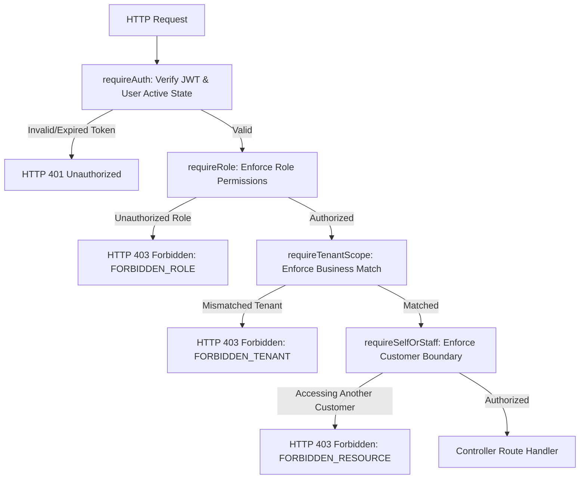

# Authentication & Authorization Architecture Specification
**Universal Multi-Tenant Bakery Management Platform**

---

## 1. Overview & Architecture

The platform uses a stateless, token-based authentication system built with **JSON Web Tokens (JWT)** and **Bcrypt.js** password hashing, enforced across all client portals (Customer, Staff, Owner).

### Core Security Guarantees:
1. **Never Trust Frontend Tenant IDs**: The authenticated user's `business_id` is strictly derived from the verified user record and encoded inside the cryptographically signed JWT. Frontend request headers or bodies cannot elevate privileges or switch businesses.
2. **Strict Tenant Segregation**: Every resource query is filtered by `business_id`. Users from Business 1 cannot read or modify data belonging to Business 2.
3. **Role-Based Access Control (RBAC)**: Backend endpoints declare exact role requirements via reusable middleware (`requireRole`).
4. **Customer Self-Access Enforcement**: Customers can only view and mutate their own private resources (addresses, order history, feedback).
5. **No Password Exposure**: Password hashes are never logged, cached in memory, or included in any API response envelope.

---

## 2. Supported Roles & Access Matrix

| Role | Access Scope | Intended Portal | Allowed Operations |
|---|---|---|---|
| **customer** | Scoped to own customer account & public menu | Customer PWA | Browse active products, customize variants, place orders, scan UPI QR, track order, leave reviews. |
| **staff** / **baker** | Scoped to assigned `business_id` | Staff Portal | View today's baking task queue, view recipe BOMs, accept/reject batches, log wastage. |
| **manager** | Scoped to assigned `business_id` | Staff + Management | Verify UPI payments, adjust inventory lots, approve batch costs, assign workers. |
| **owner** | Scoped to assigned `business_id` | Owner Analytics | Full business settings, recipe margins, staff payroll rates, P&L analytics, vendor contracts. |

---

## 3. JWT Token Specification

Tokens are signed using `HMAC-SHA256` with the server's `JWT_SECRET`.

### Token Payload Structure
```json
{
  "sub": 4,
  "business_id": 1,
  "role": "customer",
  "iat": 1727938800,
  "exp": 1728543600
}
```

- `sub` *(Subject)*: Internal primary key of the user (`users.id`).
- `business_id`: The tenant identifier (`businesses.id`).
- `role`: The authorized role (`customer`, `staff`, `baker`, `manager`, `owner`).
- Sensitive data (passwords, emails, phone numbers, financial details) is **never** included in the token.

---

## 4. Reusable Middleware Pipeline



### 1. `requireAuth`
- Validates the `Authorization: Bearer <token>` header.
- Verifies signature and expiration against `JWT_SECRET`.
- Verifies that the user exists and `is_active === true` in the database repository.
- Injects `req.user = { id, business_id, role, name, email, phone }`.

### 2. `requireRole(...allowedRoles)`
- Guards protected routes.
- Example: `router.post('/batches', requireAuth, requireRole('owner', 'manager', 'baker'), ...)`
- Rejects unauthorized roles with HTTP `403 Forbidden` (`FORBIDDEN_ROLE`).

### 3. `requireTenantScope(resolverOrParam)`
- Guarantees that any business-owned resource matches `req.user.business_id`.
- Prevents cross-tenant parameter tampering (`/api/orders/:orderId` where `order.business_id !== req.user.business_id`).
- Rejects cross-tenant attempts with HTTP `403 Forbidden` (`FORBIDDEN_TENANT`).

### 4. `requireSelfOrStaff(paramName)`
- Prevents Customer A from accessing Customer B's private orders or addresses.
- Grants access if `req.user.id === targetUserId` OR if the user is a `staff`, `manager`, or `owner` of the same business.

---

## 5. Authentication Endpoints

### 1. Register Customer
- **Endpoint**: `POST /api/auth/register`
- **Public**: Yes
- **Constraint**: Public registration **strictly assigns `role = 'customer'`**. It cannot create staff or owner accounts.
- **Request Body**:
  ```json
  {
    "businessSlug": "crumbandco",
    "name": "Ananya Nair",
    "email": "ananya.nair@gmail.com",
    "phone": "+91 98201 54321",
    "password": "Password@123"
  }
  ```
- **Response**:
  ```json
  {
    "success": true,
    "data": {
      "token": "eyJhbGciOiJIUzI1NiIsInR5cCI6IkpXVCJ9...",
      "user": {
        "id": 4,
        "business_id": 1,
        "name": "Ananya Nair",
        "email": "ananya.nair@gmail.com",
        "phone": "+91 98201 54321",
        "role": "customer"
      },
      "business": {
        "id": 1,
        "name": "Crumb & Co.",
        "slug": "crumbandco",
        "currency": "INR"
      }
    }
  }
  ```

### 2. User Login
- **Endpoint**: `POST /api/auth/login`
- **Public**: Yes (Customer, Staff, Manager, Owner)
- **Request Body**:
  ```json
  {
    "businessSlug": "crumbandco",
    "identifier": "ananya.nair@gmail.com",
    "password": "Password@123"
  }
  ```
- **Response**: Returns signed JWT token and sanitized profile.

### 3. Current User Profile
- **Endpoint**: `GET /api/auth/me`
- **Requires**: `requireAuth`
- **Response**: Returns current authenticated user and tenant metadata.

---

## 6. Future Integration Guide by Team

### For Your Team (Customer Portal + Owner Analytics):
- **Customer PWA**: Reads token from `localStorage('crumb_token')`. Attaches `X-Business-Slug` header dynamically based on current URL path (`/b/:businessSlug`).
- **Owner Dashboard**: Route protection guards on `/owner/*` requiring `role === 'owner'`. Analytics endpoints will query aggregations filtered strictly by `WHERE business_id = req.user.business_id`.

### For Partner Team (Staff Portal):
- **Staff Authentication**: Staff will log in via `/staff/login` submitting their business slug and credentials.
- **Task Board & Batch Operations**: Staff endpoints (`/api/staff/batches/*`) must declare `requireAuth, requireRole('staff', 'baker', 'manager')`. All database queries will filter by `req.user.business_id`.
